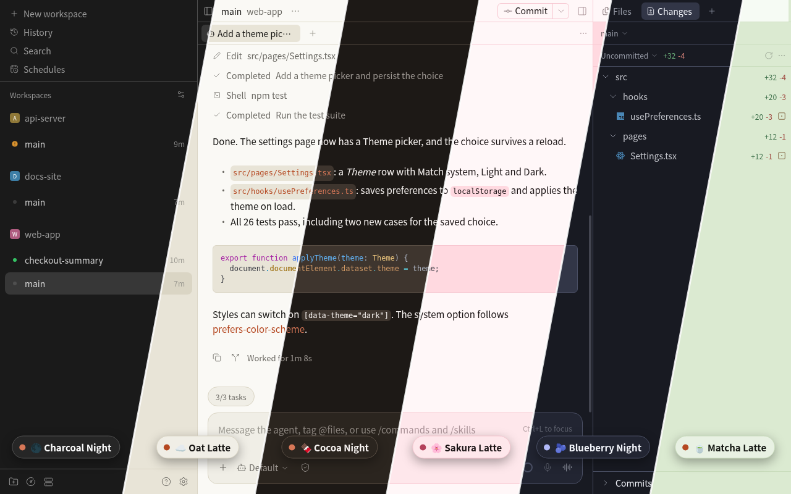
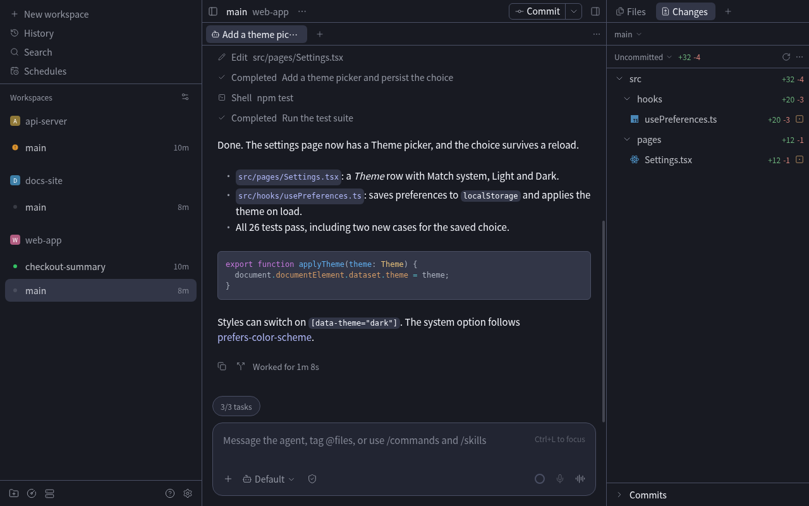
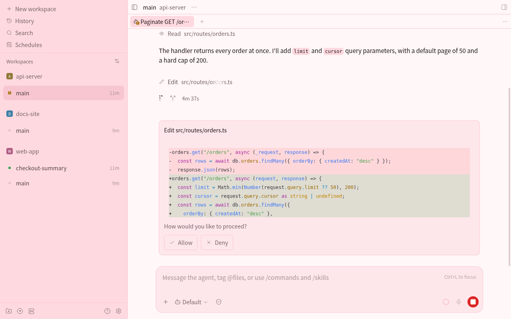

# Terracotta Themes

六套 Paseo 主题，三深三浅，共用同一条在 OKLCH 里推导的色调阶梯。在 **Settings → Appearance → Theme** 里按 emoji 列出；桌面端、浏览器和手机端都能用，只要客户端连的是装了本插件的 daemon。

> 非官方项目，与 Anthropic 无关，也未获其认可。配色的明度骨架取自 Claude Code CLI 内置主题的颜色值；Claude 和 Claude Code 是 Anthropic 的商标。



| 主题 | 外观 | 底色 | 卡片 | 强调色 | 性格 |
| --- | --- | --- | --- | --- | --- |
| 🌑 Charcoal Night | dark | `#1A1A1A` | `#262626` | `#D77757` | 逐字节复现 Claude Code CLI 的深色配色：中性灰配赤陶 |
| ☁️ Oat Latte | light | `#FAF9F5` | `#F0EEE6` | `#B54821` | 燕麦奶油白配压暗的赤陶 |
| 🍫 Cocoa Night | dark | `#1D1916` | `#2B251F` | `#D77757` | 暖褐，深色锚点的精修版 |
| 🫐 Blueberry Night | dark | `#181A22` | `#222532` | `#B1B9F9` | 靛蓝配长春花紫 |
| 🌸 Sakura Latte | light | `#FFF7F8` | `#FEE7EB` | `#B4415B` | 樱花粉配深玫瑰 |
| 🍵 Matcha Latte | light | `#F6FBF4` | `#E8F1E3` | `#B54821` | 抹茶绿配赤陶（近互补） |

需要 Paseo 0.11.0 或更高版本（manifest 用了 `name`、`icon`、`media`，0.11 以前的 daemon 拒绝安装）。插件只在客户端注册主题：没有设置项，没有服务端部分，不联网、不读写文件、不起子进程。代码块的语法高亮是 Appearance 里单独的设置，不随主题变化。





## 配色不是手调的

`addTheme` 只收 8 个颜色，Paseo 把它们展开成面板、菜单、diff、状态色和终端的完整 token 集。所以这 8 个值必须彼此有关系，否则展开出来就散了。

做法是在 **OKLCH** 里推导，而不是在 hex 里试。OKLCH 的明度是感知均匀的：同一条明度阶梯换个色相，视觉深浅完全一致。于是粉色主题和靛蓝主题的卡片"浮起来"的程度是一样的。

骨架本身是**测**出来的：读出 Claude Code CLI（`2.1.263`）内置主题对象里的颜色，逐个换算成 OKLCH 坐标：

| Paseo token | OKLCH L | CLI 主题里的来源 |
| --- | --- | --- |
| `background` | 0.218 | 无（终端主题没有底色，见下） |
| `raised` | 0.269 | `composerSidebarBackground:"rgb(38,38,38)"` |
| `control` | 0.337 | `userMessageBackground:"rgb(55,55,55)"` |
| `border` | 0.431 | `subtle:"rgb(80,80,80)"` |
| `mutedForeground` | 0.683 | `inactive:"rgb(153,153,153)"` |
| `ring` | 0.627 | `promptBorder:"rgb(136,136,136)"` |
| `accent` | 0.670 | `claude:"rgb(215,119,87)"`，色相 **H39.1°** |

**把彩度设为 0 喂给这套骨架，出来的就是 CLI 的深色配色，8 个值逐字节一致**，也就是 🌑 Charcoal Night；这条有测试守着（`tests/palette.test.ts`）。所以其余五套不是"另外画的主题"，而是同一套主题换了色相。

两个从 CLI 搬来的色相反复出现：赤陶 **H39.1°**（强调色）和长春花紫 **H278.6°**（CLI 用来框权限请求的那个紫）。🫐 Blueberry Night 的强调色就是 `#B1B9F9` 本身。

### 彩度是递增的

浅色系测出来有个细节：**表面越深，彩度越高**（`#FAF9F5` C0.005 → `#DAD5C4` C0.024）。这正是奶油色看起来"有设计"而不是"发灰"的原因。这条斜坡被抽成 `surfaceC: [0.22, 0.45, 0.75, 1.0]`，全家族共用。

### 刻意的偏离

- **`background` 是补的**：终端主题没有自己的底色（它继承终端）。深色 `#1A1A1A` 压在 composer 侧栏色下面一档，浅色用奶油白 `#FAF9F5`。
- **浅色 `accent` 压暗了**：`#D77757` 在奶油底上只有 3.0:1。保持色相放到浅色配方的 L=0.542，得到 `#B54821`，对底色 5.1:1、对卡片 4.6:1。
- **浅色锚点的 `ring` 改了**：CLI 用的 `#999999` 是纯中性灰，落在一整套暖色调里显得发冷。现在由配方生成 `#9B9991`，带上同样的暖色相。深色锚点不动。
- **🫐 Blueberry 的强调色不走配方明度**：`#B1B9F9` 保留它自己的 L=0.8025，否则会被压成灰扑扑的 `#8990CD`。

### sRGB 装不下的部分

浅色底色在 L=0.982 那么亮的地方，sRGB 能容纳的彩度非常有限。🌸 Sakura 的底色请求 C0.0128，实际只拿到 C0.0087。色域拟合器的选择是**保色相、让彩度**：直接裁 RGB 通道会把粉色扭成别的颜色。所以浅色主题是"奶盖在上面"的观感：页面接近白，卡片才吃色。这是 sRGB 的硬约束，不是配置没调够。

## 看一眼

```bash
npm run preview   # 生成 preview/dist/themes.png，六套主题的 UI 模拟图
```

产物在 `preview/dist/`（已 git ignore）。数值达标不等于好看，改完配色建议渲一张看看。

`assets/` 里的截图来自 Paseo 0.11.1 的 web 端，项目、对话和代码都是虚构的演示数据；`icon.svg` 是 `icon.png` 的源文件，每张色卡是一套主题：顶上是强调色，往下依次是 border、control、raised、background。

## 校验

测试用 Node 自带 runner（`node --test` + 类型擦除），不引入 vitest，依赖树 17 个包，全是开发依赖。38 条断言分五层：

- **色彩转换**：8 个已知色 OKLCH 往返无损；色域外的颜色必须保住色相（漂移 <1.5°）而不是裁通道。
- **忠实度**：配方仍然复现 CLI 的深色配色和 `#B1B9F9`。改坏任何一个常数都会红。
- **可用性**：每个主题对象都符合客户端的严格 schema（名称 1 到 60 个字符、没有多余字段、颜色是 `#RRGGBB`）；正文对底色 ≥7:1，次要文字和强调色对底色与卡片都 ≥4.5:1；表面层级单调。
- **一致性**：同一明暗档内，各主题的次要文字对比度差异 <0.25，这是感知阶梯该买到的东西。主题 id 固定不变，显示名不用 Anthropic 的产品名。
- **打包**：manifest 的图标是 ≥512 px 的正方形 PNG，截图存在且每张 ≤400 KB；Paseo 版本下限与 `@getpaseo/plugin` 的钉版一致；没有 build 命令和运行时依赖；锁文件只指向 registry.npmjs.org；OVERVIEW 没有破折号和安装命令。

```bash
npm run typecheck
npm test
```

客户端产物约 6.6 KB（Paseo 0.11.1 的编译器），没有任何外部 import：两个 SDK 导入都是 `import type`，编译时擦除。所以插件不需要 build 步骤，Git 安装也不会去装依赖。

## 加一套自己的主题

在 `shared/palette.ts` 的 `SPECS` 里加一条，八行：

```ts
{
  id: "peach-latte",
  name: "🍑 Peach Latte",
  appearance: "light",
  surfaceHue: 45,          // OKLCH 色相角
  surfaceChroma: 0.05,     // border 的彩度，其余按斜坡递减
  accentHue: 30,
  accentChroma: LIGHT_ACCENT_CHROMA,
}
```

明度、对比度和层级由配方负责，不用自己试 hex。再把新的 id 和名字加进 `tests/palette.test.ts` 开头的两份清单。`id` 发布后就别再改：客户端按 `<插件 id>/theme/<主题 id>` 记住用户的选择，改了 id 用户就会被退回默认主题；显示名可以随便改。然后：

```bash
npm run typecheck && npm test && npm run preview
paseo plugin reload <插件 id>
```

测试会替你挡住对比度不够或层级反向的参数。在客户端切走再切回即可看到新值。

## 许可

MIT，见 [LICENSE](LICENSE)。
