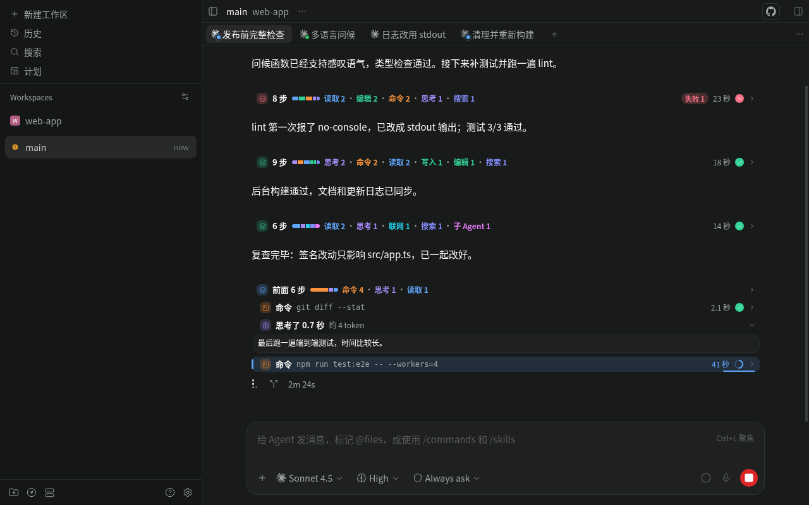
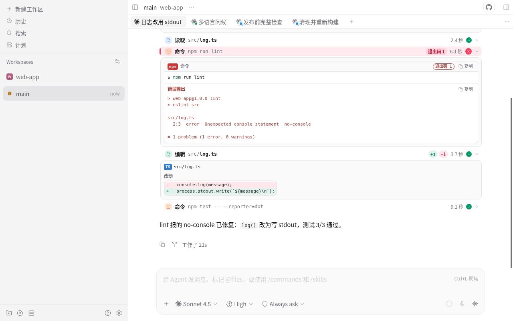
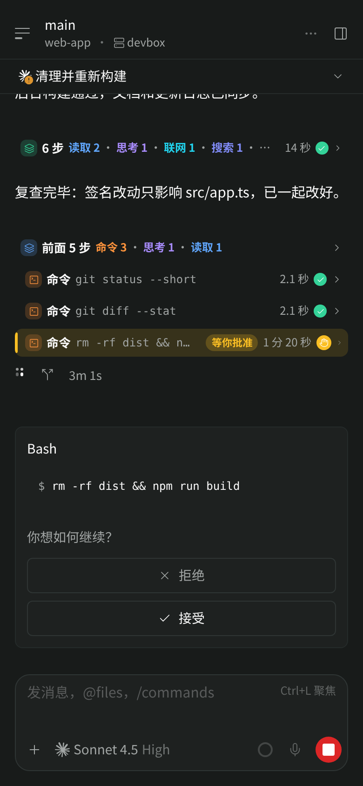
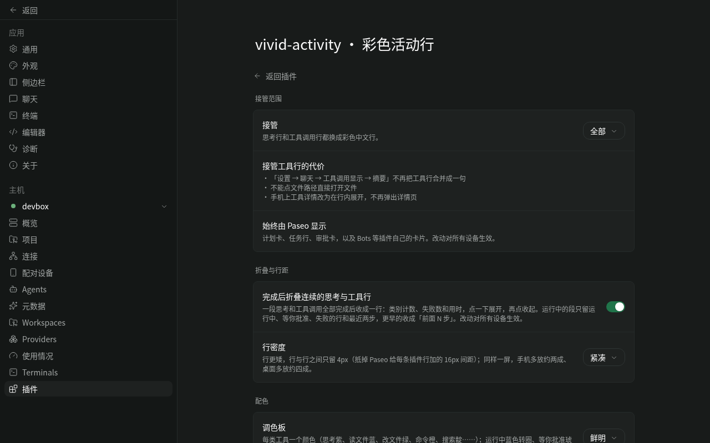

# Vivid Activity

A [Paseo](https://paseo.sh) plugin that redraws an agent's thinking and tool-call rows as compact,
color-coded activity rows with live states, folds finished runs of steps into one summary row and shows how
long every step took. The interface is in Simplified Chinese.

Based on [Colorful Agent Activity](https://github.com/mcowger/paseo-plugins/tree/e65409bbccf6d07c1bbe24dc8eddd902ee10a769/colorful-agent-activity)
0.3.0 by Matt Cowger (MIT). The layered detail cards take design ideas from
[Beautiful Chat](https://github.com/ABorakati/beautiful-chat) by ABorakati; no code or assets were copied from it.



| Detail cards | Phone |
| --- | --- |
|  |  |

## Features

- **One color per kind of step**: thinking violet, reads blue, edits green, commands orange, searches indigo,
  web requests cyan, sub-agents magenta, MCP tools pink, Paseo tools sky blue. Edits show `+N / −M`.
- **Visible states**: running rows spin and shimmer in blue, rows waiting for your approval pulse in amber as soon as
  the request arrives, a question for you shows an amber 等你回答 with a question mark, failed rows turn red and show a
  failed command's exit code, and a row that finishes while on screen flashes green once. Motion respects the
  system's reduced motion setting and pauses while the app is in the background.
- **Folding**: when a run of thinking and tool steps has finished it collapses into one row such as
  `8 步 · 读取 2 · 编辑 2 · 命令 2 · 思考 1 · 搜索 1`, with a color bar of the step kinds, a red `失败 1` badge when a
  step failed and the run's total time. Tap it to see the steps again. While the agent works, only running, waiting
  and failed steps and the two most recent ones stay open; earlier steps fold into `前面 N 步`.
- **Timing**: every row shows its duration, running rows count up live, and the fold row shows the elapsed time
  of the whole run.
- **Detail cards**: highlighted commands with output, exit code and copy buttons; file reads with a language
  badge and line numbers; colored diffs; inline previews for images the agent read; dedicated views for Paseo's
  own tools, GitHub and Exa results.
- **Readable notices**: background command, agent and monitor notices from Claude Code, and notices from Pi
  extensions (background tasks, sub-agents, web search, goals), become short Chinese rows colored by outcome, with
  fields and results in Chinese when expanded.
- **Your time zone**: times in schedule and other Paseo tool details read like 明天 05:00（9 小时后）; tap for the original.
- **Pinned question**: in a long turn, your question stays above the newest stretch of activity, three lines at first,
  tap to read it all, with a copy button.
- **Clean terminal output**: ANSI escape sequences (colors, cursor moves, line clearing, window titles, links) in
  command output and terminal captures are removed from what you see, while colored output keeps its colors. Copy
  copies the clean text; a second button copies the original when it had escape sequences.
- **Sub-agent activity**: the row for Paseo's create agent tool shows the new agent's latest three timeline
  entries while it works, as short rows the plugin's server prepares. It reads them only while the app is in the
  foreground and the card is on screen, and never wakes an agent that is closed or archived unless you ask.
- **Leaves native cards alone**: plan cards, task lists and permission prompts stay with Paseo; cards of other
  plugins, such as Bots proposals, stay with them and split the steps around them into separate folds.

## Settings

The settings page (彩色活动行) offers:

| Setting | Options |
| --- | --- |
| 接管 (takeover) | all rows (default), thinking rows only, off |
| 完成后折叠连续的思考与工具行 (fold finished steps) | on (default), off |
| 行密度 (row density) | compact (default, 4 px between rows), standard (10 px) |
| 钉住本轮提问 (pin this turn's question) | on (default), off |
| 调色板 (palette) | vivid (default), follow theme, soft, high contrast |
| 展开方式 (expansion) | per row kind: always, newest only, collapsed |

Settings are stored in Paseo's plugin settings on the daemon, so every connected device uses the same ones.



## Data access

The plugin makes no network requests, writes no files and starts no processes.

- The server part reads the projected timeline of the agent you are viewing inside the daemon and returns a
  compact fold index to the app: each row's position, end time, kind, status and category, tool call and turn ids,
  text lengths and a short hash of thinking text, never text or tool output. For the pinned question it reads that
  one user message and returns its text.
- Image previews read the image file only from the working directory of the agent whose chat shows it or from
  the system temp directory (`os.tmpdir()`, plus `/tmp` on macOS): regular files up to 3 MB, links resolved before
  the check, the opened file checked again, and no more than the first 32 bytes of a file that is not an image
  (`server/read-image.ts`).
- It reads no credentials; of the environment it uses only `TMPDIR` and `HOME`, to check the temp directory.
- Expanding a row for Paseo's create agent tool makes the server part read the last 8 entries of the new agent's
  timeline and send the app three short rows (about 500 bytes), while the app is in the foreground and the card is on
  screen; at most every five seconds while the agent keeps changing. Before each read it starts by itself, it asks
  the daemon for the agent's record, which loads nothing, and reads only an agent the record shows as loaded; when
  that check fails it reads nothing. An agent that is closed or archived is read only when you press the card's
  button, because reading it makes the daemon load it.

[OVERVIEW.md](OVERVIEW.md) lists the details and known limits, including why it cannot be combined with other
plugins that redraw the same rows.

## Install

Requires Paseo 0.11.1 or later. Git installs run the manifest's preparation step,
`npm ci --omit=dev --ignore-scripts --no-audit --no-fund`, which installs the two runtime packages from the lockfile:
`@getpaseo/protocol` (types and a tool name helper the bundle imports) and `prismjs`.

To try a local checkout, install those packages first, then point Paseo at the folder:

```sh
npm ci --omit=dev --ignore-scripts
paseo plugin install /absolute/path/to/vivid-activity
```

## Development

```sh
npm ci
npm run typecheck
npm test
npm run lint
```

The client entry (`index.client.tsx`) registers the timeline transformers and renderers and the settings
page; the server entry (`index.server.ts`) registers the settings, the `read-image`, `fold-index`, `turn-prompt` and
`child-summary` RPCs, and `vivid.client-chunk.get`, which serves the two lazily loaded chunks (`ui` and `pi`).
See [CHANGELOG.md](CHANGELOG.md) for the changes from Colorful Agent Activity.

## License

MIT. See [LICENSE](LICENSE), which keeps the original copyright notice of Colorful Agent Activity.

## Mobile loading

Timeline transforms and row headers stay ready immediately. Details, syntax highlighting and settings load when
opened; the first expansion shows plain text. Chunk source text is cached by content hash until the app restarts, so
reconnecting reuses downloads while creating fresh plugin state. Replies are downloaded sequentially and stay below
128 KB. Failed loads offer retry; incompatible versions ask for a reconnect.

The parser for Pi extension notices is a second chunk (about 48 KB), downloaded when the first such notice appears:
until it arrives those rows read Pi 通知 正在读取… ("reading") without a state, then they are redrawn. If the download
fails they still carry no state and read 没能读取，点开看原文 ("could not read, open for the original"); expanded, they
show the message as sent and a 重新读取 ("read again") button, and the download is tried again after 30 seconds, 1, 2
and then every 5 minutes. Fold summaries do not depend on it, because the server reads these notices itself.

Child-agent cards receive three short activity rows, at most every five seconds during streaming, and refresh
immediately on status changes. They do not subscribe to child timelines; a running child the host has sent no update
for in ten seconds (an ACP agent that reports no usage sends none until its turn ends) is read once more. Fold
indexes refresh on new and finished boundaries, respect a two-second minimum and retry backoff, and skip virtual
provider agents.

Generated chunks are shipped with this package. Maintainers rebuild them from the collection root with
`npm run build:chunks`; `npm run check` rejects stale artifacts.
